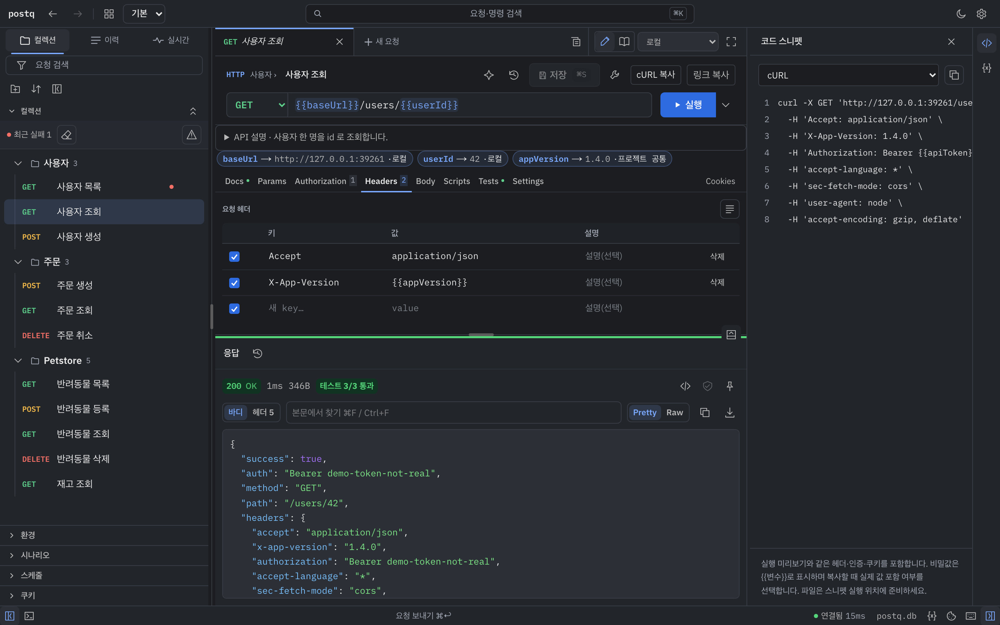
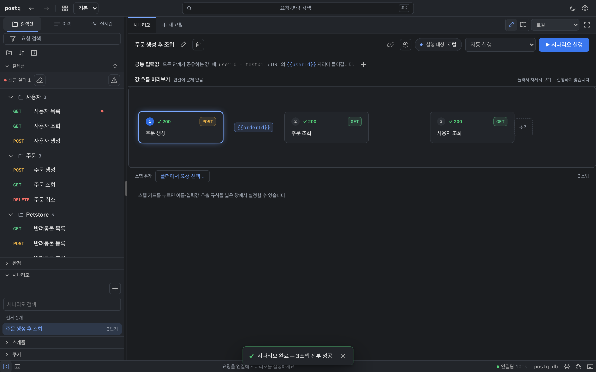
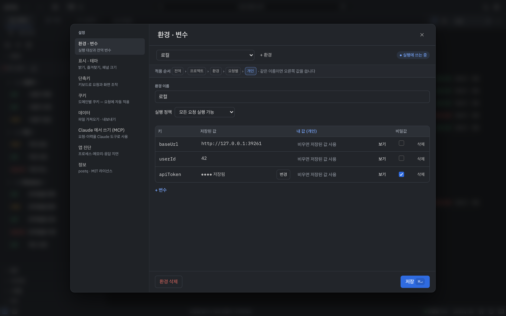
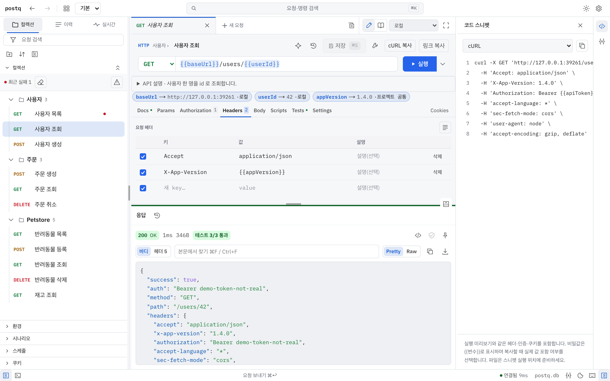

<p align="center"></p>

<h1 align="center">postq</h1>

<p align="center">postq — 쿼카가 마스코트입니다.</p>

<p align="center"><b>저장한 요청은 깨끗하게 두고, 실행은 전부 이력에 남기는 작은 로컬 API 클라이언트</b></p>

<p align="center"><a href="README.md">English</a></p>

데스크톱 앱·도커·로컬 웹앱으로 쓰는 개인용 API 클라이언트(Postman 비슷한 것)다.
**설정 → 표시 → 언어**에서 시스템·한국어·English를 선택하면 즉시 적용된다.
저장한 요청은 **바뀌지 않는 템플릿**이고, 실행할 때마다 실제로 보낸 값과 받은 응답이 **이력에 쌓인다.**
값을 고쳐 가며 실행해도 원본은 더러워지지 않는다.

**Postman 데스크톱 vs postq** — 대기 상태, 같은 Apple M4 Pro 맥
([조건과 방법](docs/benchmark.md#postman-데스크톱-앱-vs-postq). Postman 은 사용자가 켜 둔 앱을 읽기만 했다):

| | Postman 데스크톱 12.27.2 | postq 데스크톱 앱 | postq CLI |
|---|---:|---:|---:|
| 디스크(앱·설치) | 460.5 MiB | 23.7 MiB | 5.7 MiB |
| 대기 메모리, footprint 합 | ≈816 MiB (856 MB) | 107.1 MiB | 서버 2.8 MiB (+ 브라우저 탭, headless Chromium 에서 ≈50 MiB) |
| 대기 메모리, RSS 합 | 835 MiB | 269.5 MiB | 서버 5.6 MiB (+ npm 런처 34.7 MiB) |

Postman은 이미 사용 중이던 앱에서 읽은 값입니다. postq와 작업량·앱 상태가 달라 동일 조건의 통제된 비교가 아닙니다.

- 백엔드: `server/` 의 Rust([axum](https://github.com/tokio-rs/axum)) — API 와 화면을 함께 낸다.
- 화면: `src/` 의 Next.js 정적 내보내기(React). 한국어와 영어를 지원한다.
- 데스크톱: `src-tauri/` 의 [Tauri](https://tauri.app) — Rust 서버를 같은 프로세스 안에서 띄운다. 실행에 Node 가 없다.
- 저장소: SQLite 파일 하나.

> **로그인이 없다.** 서버에 닿는 사람은 누구나 모든 요청과 비밀값을 쓴다. 그래서 기본은 전부 `127.0.0.1` 에만 연다.
> 바깥에 열기 전에 [보안](#보안) 을 읽는다.

## 기능

- **템플릿과 실행의 분리** — 폴더 트리의 요청은 깨끗한 원본이다. 값을 고쳐 실행하면 보낸 값·상태·본문·소요시간·환경이
  이력으로 남는다. 이력을 누르면 그때 값이 돌아와 바로 다시 실행할 수 있다. 템플릿은
  [편집] → [템플릿 저장] 으로만 바뀌고, 저장할 때마다 요청 버전으로 남는다.
- **컬렉션·폴더** — 폴더 공용 인증, 끌어서 순서 바꾸기, 즐겨찾기, 검색.
- **환경·변수** — `{{baseUrl}}` 같은 변수를 서버에서 치환한다. 전역 변수도 있다. `secret` 으로 표시한 변수는 응답과
  이력에 실값이 남지 않는다(`SECRET_ENCRYPTION_KEY` 를 주면 암호화해 저장).
- **인증** — Bearer, Basic, API 키, OAuth2 client credentials.
- **본문** — JSON, 폼, multipart(파일 업로드), GraphQL(스키마 조회 포함).
- **시나리오** — 요청을 이어 실행하고, 단계 사이에 값을 넘기고, 검증(assertion)을 단다.
- **스케줄** — 서버가 시나리오를 주기적으로 돌리고 결과를 남긴다. Slack·Teams·Discord 웹훅 알림(선택).
- **이력** — 요청별·전체 이력, 실행끼리 응답 비교, 예시 응답 고정.
- **가져오기·내보내기** — Postman 컬렉션·환경, postq 내보내기 파일. 폴더를 OpenAPI 로 내보내기.
- **OpenAPI 주소로 가져와 동기화** — OpenAPI(Swagger) 주소로 폴더를 만든다. 폴더의 ⟳ 버튼을 누르면 새 엔드포인트는
  추가(`NEW`), 바뀐 것은 갱신(`CHANGED`), 스펙에서 사라진 것은 지우지 않고 `DEPRECATED` 로 표시한다(이력 보존).
- **쿠키 관리자**, 그리고 로그인된 도메인의 쿠키를 postq 로 보내는 브라우저 확장(`extension/`).
- **실시간** — WebSocket·SSE 패널.
- **MCP 서버 내장** — 각자의 AI 클라이언트(Claude Code·Claude Desktop 등)가 요청을 찾고 실행하고 이력을 본다.
- **명령줄 실행기** — `scripts/run-collection.sh`(CI 용 JUnit 출력), `scripts/run-scenario.mjs`.
- 명령 팔레트, 단축키(Option/Alt 를 누르고 있으면 보인다), 테마, 설정.

## 스크린샷



| 시나리오 | 설정 | 라이트 테마 |
|---|---|---|
|  |  |  |

데모 데이터로 `node scripts/screenshots.mjs --lang ko --out docs/screenshots/ko` 를 실행해 다시 찍습니다(headless Chromium, 로컬 데모 서버만 사용).

## 크기·메모리

Apple M4 Pro 맥에서 Postman CLI 1.84.0 과 같은 컬렉션(요청 4개)으로 잰 값(5회 중앙값, 방법은 [docs/benchmark.md](docs/benchmark.md)).
Postman CLI 는 컬렉션 실행기이고, postq 는 화면까지 내는 서버 전체다. 데스크톱 앱 비교는 이 문서 맨 위에 있다.

| | Postman CLI | postq |
|---|---:|---:|
| 설치 크기(`npm install -g`) | 366.2 MiB | 5.6 MiB |
| 대기 메모리 | — | 5.4 MiB |
| 컬렉션 실행 중 최대 메모리 | 606.1 MiB | 서버 7.3 MiB (+ Node 실행 스크립트 45.1 MiB) |

## 설치·실행

### 명령어로 쓰기(npm 또는 Homebrew)

```bash
npm install -g @postq/postq
postq            # http://127.0.0.1:39200 에서 시작(차 있으면 다음 빈 포트)하고 브라우저를 엽니다

# 또는
brew install JPWon-1/tap/postq
postq
```

npm 런처는 v0.1.1에서 `@postq/postq`로 배포한다. v0.1.0은 GitHub Releases와 Homebrew에서 받을 수 있다. 설치 뒤 실행 명령은 `postq` 그대로다.

미리 빌드한 실행 파일이라 Rust 나 빌드 과정이 필요 없습니다.

| OS | 아키텍처 | 상태 |
|---|---|---|
| macOS | arm64 (Apple Silicon) | 로컬 실행 확인 — M4 Pro 맥에서 로컬 npm tarball·Homebrew 설치 확인 |
| macOS | x64 (Intel) | CI 에서 확인 예정 — arm64 러너에서 교차 빌드, 실행은 아직 안 함 |
| Windows | x64 | CI 에서 확인 예정 — 설치 smoke(npm 설치·시작·health 확인·실제 콘솔 Ctrl+C / Ctrl+Break 로 종료) |
| Linux (glibc 2.35 이상) | x64 | CI 에서 확인 예정 — 설치 smoke(npm 설치·시작·health 확인) |
| Linux (glibc 2.35 이상) | arm64 | CI 에서 확인 예정 — 릴리스 빌드 + `--version` |

| 옵션 | |
|---|---|
| `--port <N>` | 이 포트만 씁니다(기본: 39200 부터 첫 빈 포트) |
| `--data-dir <폴더>` | DB 와 키 파일 위치 |
| `backup [파일]` | DB 와 짝이 되는 키 파일을 백업합니다 |
| `--no-open` | 브라우저를 열지 않습니다 |
| `--version`, `--help` | |

데이터는 `~/Library/Application Support/postq`(macOS), `%APPDATA%\postq`(Windows),
`$XDG_DATA_HOME/postq` 또는 `~/.local/share/postq`(Linux)에 `postq.db` 와 `secret.key` 로 남습니다.
키는 저장한 비밀값을 암호화하며, `SECRET_ENCRYPTION_KEY` 를 주지 않으면 처음 실행할 때 만듭니다 — DB 와 함께
백업하세요. `postq backup [파일]` 은 일관된 SQLite 사본을 만들고(기본: `<데이터 폴더>/backups`의 날짜가 붙은
`.db`), `secret.key` 가 있으면 같은 이름의 `.key` 도 복사합니다. 복원할 때는 postq 를 중지하고
기존 `postq.db-wal` 과 `postq.db-shm` 을 지운 뒤 사본을 `<데이터 폴더>/postq.db`, 짝인 키를
`<데이터 폴더>/secret.key` 로 복사하고 다시 시작하세요.
`SECRET_ENCRYPTION_KEY` 를 외부에서 주었다면 그 값은 별도로 보관해야 합니다. 대기 중인 스키마 이관 직전에는
자동 백업하고 최근 5개를 유지합니다. 끝낼 때는 Ctrl+C.

### 소스에서 빌드

필요한 것: Node.js 22.13+, Rust stable 툴체인(`curl --proto '=https' --tlsv1.2 -sSf https://sh.rustup.rs | sh`).

```bash
npm ci
```

### 데스크톱 앱(Tauri)

```bash
npm run app:build                      # 정적 화면 + 런타임 준비 + tauri build (모든 번들 형식)
npm run app:build -- --bundles app     # macOS: .app 만 만들고 .dmg 는 건너뛴다
```

결과물은 `src-tauri/target/release/bundle/` 에 나온다. 앱은 Rust 서버를 자기 프로세스 안에서 `127.0.0.1:39100`
(막혀 있으면 39110 까지 다음 빈 자리)에 띄운다. 데이터와 설정:

- 기본은 OS 앱 데이터 폴더의 `postq.db` 를 쓴다.
- `POSTQ_DIR` 로 저장소 폴더를 지정하면(또는 `npm run app:dev` 디버그 빌드면 빌드한 저장소 폴더) 그 폴더의
  `data/dev-snapshot.db`(있을 때)를 쓰고 `.env`·`.env.local` 을 읽는다.
- 앱 데이터 폴더의 `app.env` 는 언제나 마지막에 읽는다(뒤가 이기고, 이미 있는 환경 변수가 가장 앞선다).

기본은 ad-hoc 서명이라 macOS 가 재빌드마다 폴더 접근을 다시 묻는다. 고정하려면 `sh scripts/setup-local-signing.sh` 로 로컬 서명 인증서를 만든다.

### 도커

```bash
docker compose up --build
```

compose 없이:

```bash
docker build -t postq . && docker run -p 127.0.0.1:3000:3000 -v postq-data:/data postq
```

<http://localhost:3000> 으로 연다. SQLite 파일은 볼륨의 `/data/postq.db` 다. 포트에 붙은 `127.0.0.1:` 을 지우지 않는다 —
`-p 3000:3000` 으로 열면 같은 망의 누구나 로그인 없이 쓴다. 백업은 `scripts/backup.sh`.

### 개발 모드

```bash
npm run dev    # Rust API 127.0.0.1:3001 + 화면 핫리로드(next dev) 127.0.0.1:3000
```

<http://localhost:3000> 으로 연다. 계정이나 이름 입력 없이 바로 작업 화면이 열린다.
DB 는 기본 `data/dev-snapshot.db` 이고 `DB_PATH=/경로/파일.db npm run dev` 로 바꾼다. `drizzle/` 의 마이그레이션은
기동할 때 적용된다. 공개하면서 스키마를 초기 마이그레이션 하나로 합쳤으므로, 공개 이전 빌드가 만든 DB 는 올려 주지 않는다.
빈 DB 로 시작한다.

도커·데스크톱 앱이 싣는 구성 그대로 로컬에서 띄우려면:

```bash
npm run build                          # 화면 → out/
(cd server && cargo build --release)
POSTQ_STATIC_DIR=out MIGRATIONS_DIR=drizzle DB_PATH=/tmp/postq.db server/target/release/postq-server
```

스키마의 원본은 `src/db/schema.ts` 다. 고친 뒤 `npx drizzle-kit generate` 로 `drizzle/` 에 마이그레이션을 더한다.

## MCP 연결

postq 는 `/api/mcp/mcp` 에 MCP 서버(Streamable HTTP)를 낸다. 서버는 LLM 을 부르지 않는다 — 생각은 사용자의 AI
클라이언트가 하고, postq 는 그 도구가 된다.

```bash
claude mcp add --transport http postq http://127.0.0.1:39200/api/mcp/mcp
```

`postq` 가 시작할 때 찍는 주소를 쓴다(기본 39200, 막혀 있으면 다음 빈 포트). 도커·`npm run dev` 는
`http://localhost:3000/api/mcp/mcp`, 데스크톱 앱은 `http://localhost:39100/api/mcp/mcp` 다. 이 저장소를 Claude Code 로 열면 `.mcp.json` 으로
자동으로 붙는다. `MCP_TOKEN` 을 정했으면 `--header "Authorization: Bearer <토큰>"` 을 더한다.

도구: `search_requests`, `get_request`, `execute_request`, `get_history`, `run_scenario`, `create_scenario`,
`get_workspace_info`.

## 보안

postq 는 한 사람이 한 컴퓨터에서 쓰도록 만들었다.

- **로그인·계정·권한이 없다.** 포트에 닿는 사람은 저장된 비밀값으로 요청을 실행하고, 서버를 거쳐 그 서버가 닿는
  내부망으로 요청을 보내고, 데이터를 고치거나 지울 수 있다.
- **기본은 루프백.** 서버 단독·`npm run dev`·도커 포트·데스크톱 앱 모두 `127.0.0.1` 에만 연다. `POSTQ_HOST=0.0.0.0` 으로
  열면 기동할 때 경고가 뜬다. 다른 기기에서 쓰려면 SSH 터널(`ssh -L 3000:127.0.0.1:3000 <서버>`)이나 VPN 을 쓴다.
- **다른 웹사이트가 부리지 못한다.** `Host` 가 루프백 이름이 아니면 거절하고(DNS 리바인딩), 브라우저가 다른 사이트에서
  보낸 `/api` 요청(같은 컴퓨터의 다른 포트 페이지 포함)은 403 이다. curl·스크립트·MCP 클라이언트·브라우저 확장은
  그대로 된다. 프록시 뒤나 LAN 주소로 열면 그 호스트 이름을 `POSTQ_ALLOWED_HOSTS`(쉼표로 구분, 포트 없이)에 적는다.
- **팀으로 쓰려면** 앞단에 인증 프록시(oauth2-proxy·Pomerium·Cloudflare Access·Tailscale 등)를 두고, 그 프록시를
  거치지 않는 길이 없게 한다. [`docs/auth.md`](docs/auth.md) 를 본다.
- 쓸 만한 설정: `SECRET_ENCRYPTION_KEY`(비밀값 암호화 저장 — 잃어버리면 복호화할 수 없다),
  `BLOCK_PRIVATE_NETWORKS=1`(사설망·루프백 대상으로 못 보내게 — 적힌 호스트만 보므로 공개 도메인이 사설 IP 로
  풀리는 경우는 못 막는다), `MCP_TOKEN`(`/api/mcp/*` 에 Bearer 토큰 요구),
  `EXECUTION_RETENTION_DAYS`(오래된 이력 정리, 고정한 예시 응답은 남김).

## 기여

메인테이너 문서: [AGENTS.md](AGENTS.md) · [검증 하네스](docs/HARNESS.md) · [버전 관리](docs/VERSIONING.md) · [배포 절차](docs/RELEASING.md) · [변경 기록](CHANGELOG.md).

[CONTRIBUTING.md](CONTRIBUTING.md) 를 본다. 버그 제보와 PR 을 환영한다.

## 라이선스

[MIT](LICENSE)
