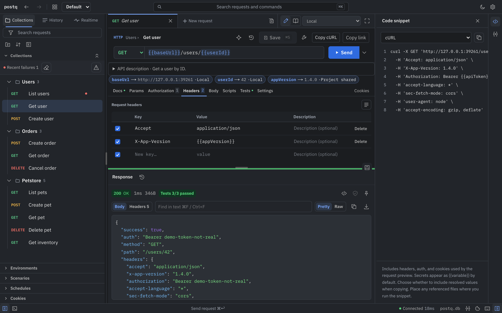
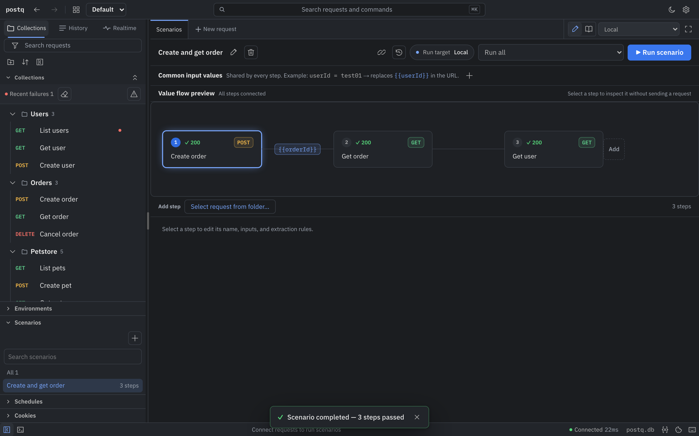
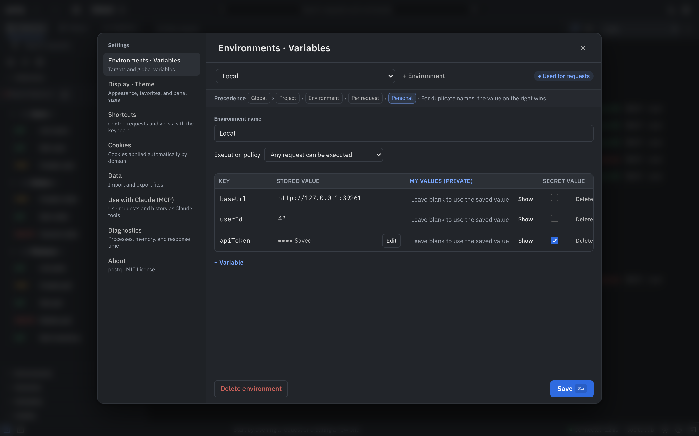
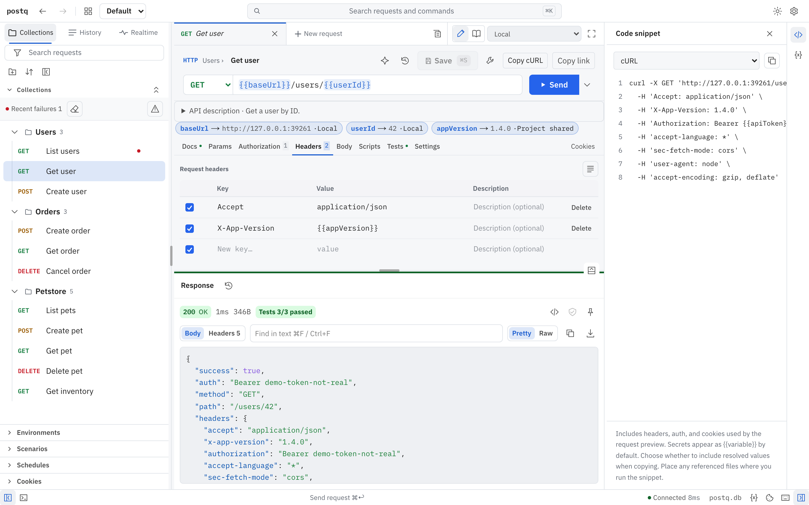

<p align="center"></p>

<h1 align="center">postq</h1>

<p align="center">postq — a quokka is our mascot.</p>

<p align="center"><b>A small local API client: saved requests stay clean, every run is kept in history.</b></p>

<p align="center"><a href="README.ko.md">한국어</a></p>

A personal API client (think Postman) that runs as a desktop app, a Docker container, or a local web app.
Choose **Settings → Display → Language** to use System, 한국어, or English; the change applies immediately.
Saved requests are **immutable templates**; every run is **appended to history** with what was actually sent
and what came back. Editing values to try something never dirties the original.

**Postman desktop vs postq** — idle, on the same Apple M4 Pro Mac
([conditions and method](docs/benchmark.md#postman-desktop-app-vs-postq); Postman was the user's running copy, read only):

| | Postman desktop 12.27.2 | postq desktop app | postq CLI |
|---|---:|---:|---:|
| Disk (app / install) | 460.5 MiB | 23.7 MiB | 5.7 MiB |
| Idle memory, sum of footprint | ≈816 MiB (856 MB) | 107.1 MiB | 2.8 MiB server (+ your browser tab, ≈50 MiB in headless Chromium) |
| Idle memory, sum of RSS | 835 MiB | 269.5 MiB | 5.6 MiB server (+ 34.7 MiB npm launcher) |

Postman was measured from an already-used, running app; its workload and state differ from the postq measurements, so this is not a controlled like-for-like benchmark.

- Backend: Rust ([axum](https://github.com/tokio-rs/axum)) in `server/` — serves both the API and the UI.
- UI: Next.js static export in `src/` (React), available in English and Korean.
- Desktop: [Tauri](https://tauri.app) in `src-tauri/` — runs the Rust server in-process, no Node at runtime.
- Storage: a single SQLite file.

> **There is no login.** Anyone who can reach the server can use every request and secret. Everything binds to
> `127.0.0.1` by default. Read [Security](#security) before exposing it.

## Features

- **Templates vs. executions** — the folder tree holds clean templates; running a request (with any ad-hoc edits)
  records an execution (values sent, status, body, timing, environment). Click a history entry to restore
  those values and re-run. Templates change only through *Edit → Save template*, and each save is kept as a
  request version.
- **Collections and folders** with shared auth, drag-and-drop ordering, favorites and search.
- **Environments and variables** — `{{baseUrl}}`-style variables resolved on the server, plus global variables.
  Variables marked `secret` never appear in responses or history (optionally encrypted at rest with
  `SECRET_ENCRYPTION_KEY`).
- **Auth helpers** — Bearer, Basic, API key, OAuth2 client credentials.
- **Bodies** — JSON, form, multipart (file upload), GraphQL (with introspection).
- **Scenarios (flows)** — chain requests, pass values between steps, add assertions.
- **Schedules** — the server runs scenarios on a timer and keeps the results; optional Slack / Teams / Discord
  webhook notification.
- **History** — per request and global, response diff between executions, pinned example responses.
- **Import / export** — Postman collections and environments, postq export files; export a folder as OpenAPI.
- **OpenAPI sync** — create a folder from an OpenAPI (Swagger) URL; the refresh button adds new endpoints (`NEW`),
  updates changed ones (`CHANGED`) and marks removed ones `DEPRECATED` without deleting history.
- **Cookie manager**, plus a browser extension (`extension/`) that sends the cookies of a logged-in domain to postq.
- **Realtime** — WebSocket and Server-Sent Events panels.
- **Built-in MCP server** — let your own AI client (Claude Code, Claude Desktop, …) search, run and inspect requests.
- **CLI runners** — `scripts/run-collection.sh` (JUnit output for CI) and `scripts/run-scenario.mjs`.
- Command palette, keyboard shortcuts (hold Option/Alt to see them), themes, settings.

## Screenshots



| Scenario | Settings | Light theme |
|---|---|---|
|  |  |  |

Screenshots use demo data: `node scripts/screenshots.mjs --lang en --out docs/screenshots/en` (headless Chromium, local demo servers only).

## Size and memory

Measured against Postman CLI 1.84.0 on an Apple M4 Pro Mac (median of 5 runs, same 4-request collection; details and method in
[docs/benchmark.md](docs/benchmark.md)). Postman CLI is a collection runner; postq is a whole server with UI.
The desktop-app comparison is at the top of this page.

| | Postman CLI | postq |
|---|---:|---:|
| Install size (`npm install -g`) | 366.2 MiB | 5.6 MiB |
| Idle memory | — | 5.4 MiB |
| Peak memory running the collection | 606.1 MiB | 7.3 MiB server (+45.1 MiB Node runner script) |

## Install and run

### Command line (npm or Homebrew)

```bash
npm install -g postq
postq            # starts on http://127.0.0.1:39200 (next free port if taken) and opens the browser

# or
brew install JPWon-1/tap/postq
postq
```

Prebuilt binaries, no Rust or build step needed:

| OS | Arch | Status |
|---|---|---|
| macOS | arm64 (Apple Silicon) | Run locally — npm and Homebrew installs tested on an M4 Pro Mac |
| macOS | x64 (Intel) | To be checked in CI — cross-built on an arm64 runner, not run yet |
| Windows | x64 | To be checked in CI — install smoke test (npm install, start, health check, stop with a real console Ctrl+C / Ctrl+Break) |
| Linux (glibc 2.35+) | x64 | To be checked in CI — install smoke test (npm install, start, health check) |
| Linux (glibc 2.35+) | arm64 | To be checked in CI — release build + `--version` |

| Option | |
|---|---|
| `--port <N>` | Listen on this port only (default: first free port from 39200) |
| `--data-dir <DIR>` | Database and key file location |
| `backup [FILE]` | Snapshot the database and its paired key file |
| `--no-open` | Do not open the browser |
| `--version`, `--help` | |

Data lives in `~/Library/Application Support/postq` (macOS), `%APPDATA%\postq` (Windows) or
`$XDG_DATA_HOME/postq` / `~/.local/share/postq` (Linux): `postq.db` and `secret.key`. The key encrypts
stored secrets and is created on first run unless `SECRET_ENCRYPTION_KEY` is set — back it up together with the
database. Run `postq backup [FILE]` to create a consistent SQLite snapshot (default: a dated `.db` in
`<data-dir>/backups`) and a matching `.key` file when `secret.key` exists. To restore, stop postq,
remove any old `postq.db-wal` and `postq.db-shm`, copy the snapshot to `<data-dir>/postq.db` and
its paired `.key` to `<data-dir>/secret.key`, then restart.
If `SECRET_ENCRYPTION_KEY` is supplied externally, preserve that value separately. Pending schema migrations
automatically create a pre-migration snapshot and retain the latest five. Stop with Ctrl+C.

### From source

Requirements: Node.js 22.13+ and a stable Rust toolchain
(`curl --proto '=https' --tlsv1.2 -sSf https://sh.rustup.rs | sh`).

```bash
npm ci
```

### Desktop app (Tauri)

```bash
npm run app:build                      # static UI + runtime + `tauri build` (all bundle targets)
npm run app:build -- --bundles app     # macOS: only the .app, skip the .dmg
```

The bundle lands in `src-tauri/target/release/bundle/`. The app starts the Rust server inside its own process on
`127.0.0.1:39100` (the next free port up to 39110 if that one is taken). Data and settings:

- By default it uses `postq.db` in the OS app-data directory.
- If `POSTQ_DIR` points to a checkout (or, in a debug build from `npm run app:dev`, the checkout it was built
  from), it uses that checkout's `data/dev-snapshot.db` when it exists and reads its `.env` and `.env.local`.
- `app.env` in the app-data directory is always read last (later files win; real environment variables win over
  all of them).

Builds are ad-hoc signed; on macOS `sh scripts/setup-local-signing.sh` creates a local signing identity so
folder-access permissions survive rebuilds.

### Docker

```bash
docker compose up --build
```

or without compose:

```bash
docker build -t postq . && docker run -p 127.0.0.1:3000:3000 -v postq-data:/data postq
```

Open <http://localhost:3000>. The SQLite file is `/data/postq.db` inside the volume. Keep the `127.0.0.1:` prefix
on the port mapping — `-p 3000:3000` exposes the app to your whole network. Back up with `scripts/backup.sh`.

### Development

```bash
npm run dev    # Rust API on 127.0.0.1:3001 + Next dev server (hot reload) on 127.0.0.1:3000
```

Open <http://localhost:3000>. The workspace opens immediately, with no account or name required.
The database defaults to `data/dev-snapshot.db`; override it with `DB_PATH=/path/to.db npm run dev`.
Migrations in `drizzle/` are applied at startup. The schema was squashed into a single initial migration for the
public release, so databases created by earlier pre-release builds are not upgraded; start from an empty database.

To run the production layout locally (what Docker and the desktop app ship):

```bash
npm run build                          # UI → out/
(cd server && cargo build --release)
POSTQ_STATIC_DIR=out MIGRATIONS_DIR=drizzle DB_PATH=/tmp/postq.db server/target/release/postq-server
```

The schema source of truth is `src/db/schema.ts`. After changing it, run `npx drizzle-kit generate` to add a
migration to `drizzle/`.

## Connecting an MCP client

postq exposes an MCP server (Streamable HTTP) at `/api/mcp/mcp`. The server never calls an LLM itself — your AI
client does the thinking and uses postq as a tool.

```bash
claude mcp add --transport http postq http://127.0.0.1:39200/api/mcp/mcp
```

Use the address `postq` prints at startup (39200 by default, the next free port if taken). Docker and `npm run dev`
use `http://localhost:3000/api/mcp/mcp`; the desktop app uses `http://localhost:39100/api/mcp/mcp`. Opening this repository in Claude Code picks
up `.mcp.json` automatically. If you set `MCP_TOKEN`, add `--header "Authorization: Bearer <token>"`.

Tools: `search_requests`, `get_request`, `execute_request`, `get_history`, `run_scenario`, `create_scenario`,
`get_workspace_info`.

## Security

postq is built for one person on one machine.

- **No login, accounts or permissions.** Whoever reaches the port can run requests with your stored secrets, use the
  server as a proxy into any network it can reach, and change or delete data.
- **Loopback by default.** The server, `npm run dev`, the Docker port mapping and the desktop app all bind to
  `127.0.0.1`. Setting `POSTQ_HOST=0.0.0.0` prints a warning at startup. To use it from another machine, prefer an SSH
  tunnel (`ssh -L 3000:127.0.0.1:3000 <host>`) or a VPN.
- **Other websites can't drive it.** Requests whose `Host` isn't a loopback name are refused (DNS rebinding), and `/api`
  requests a browser sends from any other origin — including another port on localhost — get 403. curl, scripts, MCP
  clients and the browser extension are unaffected. Behind a proxy or on a LAN address, list the hostname in
  `POSTQ_ALLOWED_HOSTS` (comma-separated, no port).
- **Using it as a team:** put an authenticating reverse proxy (oauth2-proxy, Pomerium, Cloudflare Access, Tailscale,
  …) in front and make sure the proxy is the only way in. See [`docs/auth.md`](docs/auth.md) (Korean).
- Useful settings: `SECRET_ENCRYPTION_KEY` (encrypt secrets at rest — losing it means losing them),
  `BLOCK_PRIVATE_NETWORKS=1` (refuse private/loopback targets — the check looks at the host as written, so a public
  hostname that resolves to a private IP is not caught), `MCP_TOKEN` (require a bearer token on `/api/mcp/*`),
  `EXECUTION_RETENTION_DAYS` (prune old history; pinned examples are kept).

## Contributing

Maintainer guides: [AGENTS.md](AGENTS.md) · [test harness](docs/HARNESS.md) · [versioning](docs/VERSIONING.md) · [releasing](docs/RELEASING.md) · [changelog](CHANGELOG.md).

See [CONTRIBUTING.md](CONTRIBUTING.md). Bug reports and pull requests are welcome.

## License

[MIT](LICENSE)
